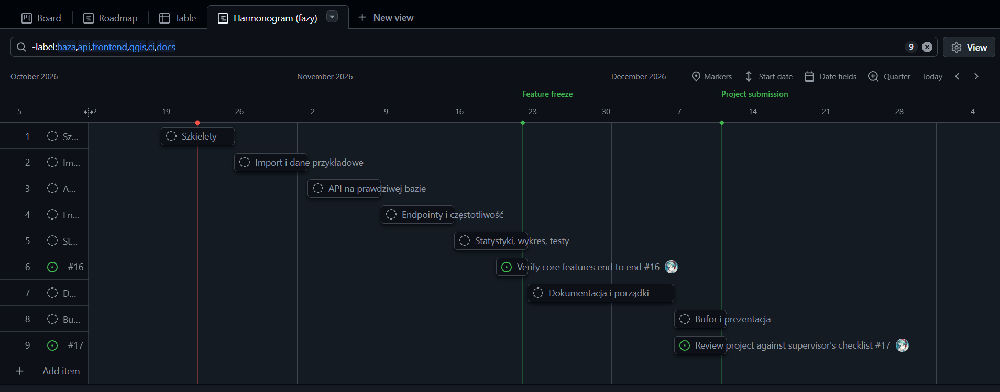
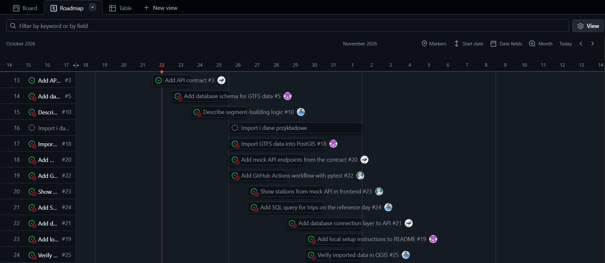

# Mapa i API stacji Kolei Dolnośląskich

Projekt geoinformatyczny, Politechnika Wrocławska, semestr zimowy.

<!-- Po skonfigurowaniu GitHub Actions dodać tu badge ze statusem CI -->

## Cel projektu

Budujemy bazę danych, API i mapę internetową na podstawie rozkładu jazdy Kolei Dolnośląskich (GTFS). Aplikacja odpowiada na dwa pytania:

1. **Najbliższy pociąg:** jaka stacja jest najbliżej wskazanego punktu i jakie są z niej najbliższe odjazdy.
2. **Częstotliwość połączeń:** które odcinki i stacje mają najwięcej kursów, a które najmniej.

Do tego dochodzą wykres, podstawowe statystyki i możliwość pobrania danych w formacie JSON/GeoJSON przez API.

Pełny plan, podział zadań i harmonogram: [docs/plan-projektu.md](docs/plan-projektu.md).

## Dane

- Źródło: pliki GTFS ze strony [Kolei Dolnośląskich](https://kolejedolnoslaskie.pl/rozklady-gtfs/).
- Rozkład obowiązuje od 08.10.2026 do 12.12.2026.
- Migawka danych (wypakowane pliki GTFS, ok. 1,6 MB) jest w katalogu `data/gtfs/`, a opis źródła i daty pobrania w [data/README.md](data/README.md).
- Licencja i sposób podania źródła: do uzupełnienia.

## Technologie

| Warstwa        | Technologia            |
| -------------- | ---------------------- |
| Baza danych    | PostgreSQL + PostGIS   |
| API            | Python, FastAPI        |
| Frontend       | React, Leaflet         |
| Analiza i mapy | QGIS                   |
| Środowisko     | Docker, Docker Compose |
| CI/CD          | GitHub Actions         |

## Struktura repozytorium

```
db/             schemat bazy i skrypty SQL
src/api/        API (FastAPI)
src/frontend/   aplikacja webowa (React + Leaflet)
data/           opis danych i skrypty pobierania (surowe dane poza repozytorium)
tests/          testy automatyczne
docs/           dokumentacja, plan projektu, kontrakt API
.github/        workflow CI/CD i szablony
```

## Wymagania

- Docker i Docker Compose,
- Node.js (tylko do pracy nad frontendem poza kontenerem),
- QGIS (tylko do analiz przestrzennych).

## Uruchomienie

Na tym etapie uruchamiana jest baza danych (PostgreSQL + PostGIS) w Dockerze. API i aplikacja webowa zostaną dodane w kolejnych zadaniach.

### Wymagania

- zainstalowany i uruchomiony Docker (Docker Desktop na Windowsie).

### Start bazy

1. Skopiuj plik ze zmiennymi środowiskowymi i uzupełnij hasło:

```bash
   cp .env.example .env
```

   W PowerShellu: `Copy-Item .env.example .env`. Plik `.env` jest w `.gitignore` i nie trafia do repozytorium.

2. Uruchom bazę w tle:

```bash
   docker compose up -d
```

3. Sprawdź, że kontener działa:

```bash
   docker compose ps
```

### Sprawdzenie PostGIS

Podstaw wartości `POSTGRES_USER` i `POSTGRES_DB` z pliku `.env`:

```bash
docker compose exec db psql -U <POSTGRES_USER> -d <POSTGRES_DB> -c "CREATE EXTENSION IF NOT EXISTS postgis;"
docker compose exec db psql -U <POSTGRES_USER> -d <POSTGRES_DB> -c "SELECT postgis_version();"
```

Drugie polecenie powinno zwrócić wersję PostGIS.

### Zatrzymanie

```bash
docker compose down        # zatrzymuje kontenery, dane w wolumenie zostają
docker compose down -v     # zatrzymuje i usuwa dane (baza startuje od zera)
```

Dane bazy są przechowywane w wolumenie Dockera, więc przetrwają restart kontenera.

### Najczęstsze problemy

- **Port jest zajęty:** inny program (np. lokalny PostgreSQL) używa tego samego portu. Zmień port po lewej stronie w `ports` w `docker-compose.yml`, np. `"5433:5432"`.
- **Zmiana hasła w `.env` nie działa:** baza inicjalizuje się tylko na pustym wolumenie. Użyj `docker compose down -v` i uruchom ponownie.

Planowane adresy po uruchomieniu (do potwierdzenia):

- API i dokumentacja: http://localhost:8000/docs
- Aplikacja webowa: http://localhost:5173

## Testy

> Sekcja w przygotowaniu.

## Zespół

| Osoba      | Rola                                         |
| ---------- | -------------------------------------------- |
| Dominika   | Baza danych i import danych                  |
| Michał     | QGIS i analiza przestrzenna                  |
| Małgorzata Derkacz (@g0sie) | Frontend i organizacja repozytorium (GitHub) |
| Weronika Mongiało (@wemon007)| API (FastAPI) i testy      |

## Harmonogram

Harmonogram prowadzimy w widoku Roadmap w projekcie GitHub (pola Start date i Target date w zadaniach). Poniżej zrzuty ze stanu na 22.10.2026.

**Fazy projektu:**



**Przykładowe zadania z tygodni 1–2:**



Szczegółowy plan: [docs/plan-projektu.md](docs/plan-projektu.md).

## Zasady pracy

Jak zakładać branche, otwierać pull requesty i korzystać z tablicy zadań: [CONTRIBUTING.md](CONTRIBUTING.md).
