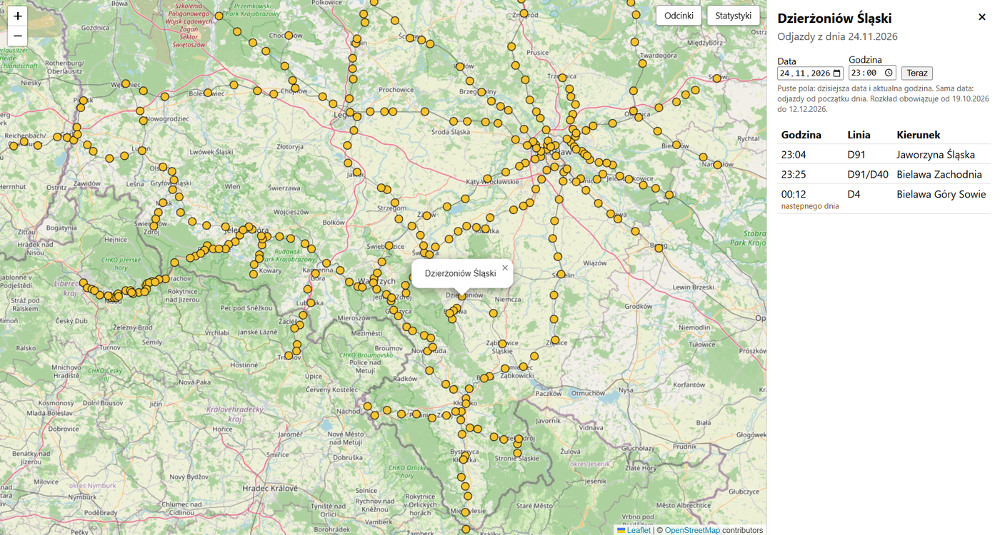
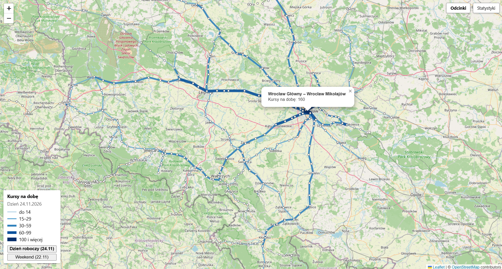
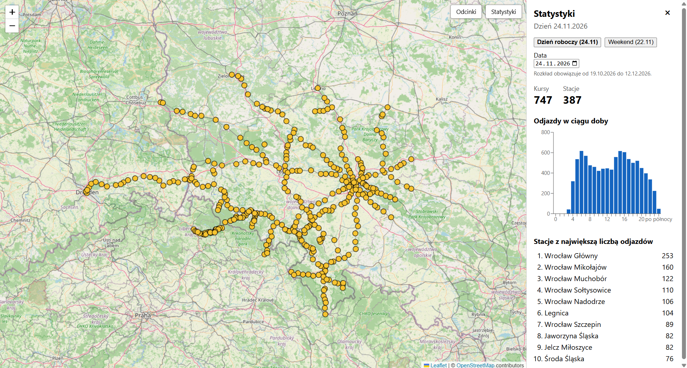
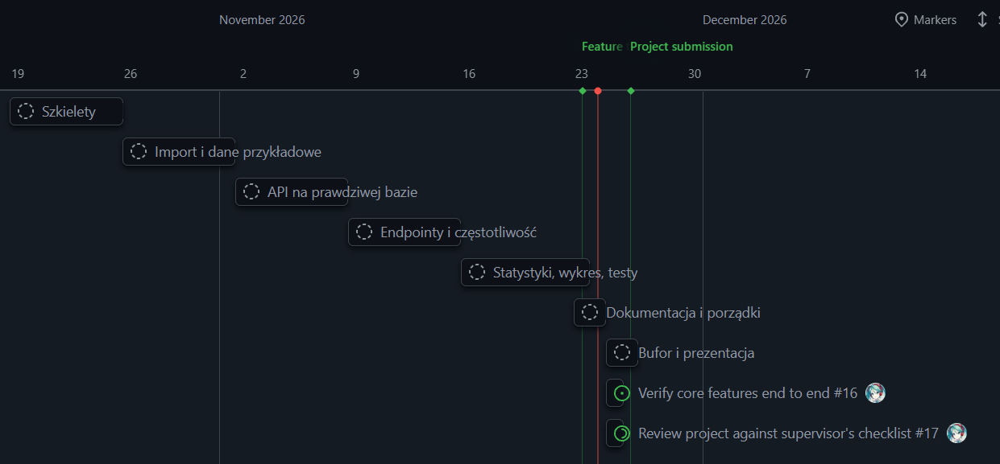

# Mapa i API stacji Kolei Dolnośląskich

Projekt geoinformatyczny, Politechnika Wrocławska, semestr zimowy.

[](https://github.com/g0sie/kd-gtfs-api/actions/workflows/tests.yml)

## Cel projektu

Budujemy bazę danych, API i mapę internetową na podstawie rozkładu jazdy Kolei Dolnośląskich (GTFS).

**Problem użytkowy:** rozkład Kolei Dolnośląskich jest publikowany jako pliki GTFS, czyli tabele tekstowe z kursami, przystankami i godzinami. Z takich plików trudno szybko odczytać, skąd najbliżej złapać pociąg i kiedy odjeżdża, ani jak gęsta jest sieć połączeń w regionie. Aplikacja pokazuje to na mapie i odpowiada na dwa pytania:

1. **Najbliższy pociąg:** jaka stacja jest najbliżej wskazanego punktu i jakie są z niej najbliższe odjazdy w wybranym dniu i o wybranej godzinie.
2. **Częstotliwość połączeń:** które odcinki i stacje mają najwięcej kursów na dobę, a które najmniej, w dniu roboczym i w weekend.

Do tego dochodzą wykres, podstawowe statystyki i możliwość pobrania danych w formacie JSON/GeoJSON przez API.

## Funkcje aplikacji

Mapa pokazuje wszystkie stacje z rozkładu (387, także stacje w Niemczech i Czechach) na podkładzie OpenStreetMap.

### Najbliższa stacja i odjazdy

Kliknięcie w dowolne miejsce mapy pokazuje najbliższą stację i odległość do niej. Przycisk „Pokaż odjazdy” w popupie otwiera panel z najbliższymi odjazdami z tej stacji.


### Panel odjazdów

Kliknięcie stacji otwiera panel z najbliższymi odjazdami: godzina, linia i kierunek. Datę i godzinę można wybrać; puste pola oznaczają dzisiejszą datę i aktualną godzinę. Kursy, które wyjeżdżają po północy, ale należą do rozkładu wybranego dnia, mają dopisek „następnego dnia”.



### Częstotliwość odcinków

Przycisk „Odcinki” włącza warstwę odcinków między stacjami. Kolor i grubość linii zależą od liczby kursów na dobę. Legenda pokazuje klasy i pozwala przełączyć dzień roboczy (24.11) albo weekend (22.11). Kliknięcie odcinka pokazuje obie stacje i liczbę kursów. Najwięcej kursów jest na odcinkach w samym Wrocławiu (np. Wrocław Główny – Wrocław Mikołajów, 160 kursów na dobę), a poza miastem wyróżnia się trasa w stronę Legnicy.



### Statystyki

Przycisk „Statystyki” otwiera panel z liczbą kursów i stacji w wybranym dniu, wykresem odjazdów w ciągu doby i rankingiem 10 stacji z największą liczbą odjazdów. Ostatni słupek wykresu („po północy”) to odjazdy po północy kursów z danego dnia.



Pełny plan, podział zadań i harmonogram: [docs/plan-projektu.md](docs/plan-projektu.md).

## Dane

- Źródło: pliki GTFS ze strony [Kolei Dolnośląskich](https://kolejedolnoslaskie.pl/rozklady-gtfs/).
- Rozkład obowiązuje od 19.10.2026 do 12.12.2026.
- Migawka danych (wypakowane pliki GTFS, ok. 1,6 MB) jest w katalogu `data/gtfs/`, a opis źródła i daty pobrania w [data/README.md](data/README.md).
- Licencja i sposób podania źródła: opisane w [data/README.md](data/README.md).

## Technologie

| Warstwa        | Technologia            |
| -------------- | ---------------------- |
| Baza danych    | PostgreSQL + PostGIS   |
| API            | Python, FastAPI        |
| Frontend       | React, Leaflet         |
| Analiza i mapy | QGIS                   |
| Środowisko     | Docker, Docker Compose |
| CI/CD          | GitHub Actions         |

## Architektura

Skrypt importu wczytuje pliki GTFS do bazy PostgreSQL + PostGIS. API w FastAPI odpowiada na zapytania zapytaniami SQL do bazy i zwraca JSON/GeoJSON. Aplikacja webowa (React + Leaflet) pobiera dane z API i rysuje je na mapie. QGIS łączy się z tą samą bazą do analiz i map. Baza, API i front działają w kontenerach Docker Compose, a testy uruchamia GitHub Actions z własną bazą PostGIS.

```
data/gtfs/ → import (db/import_gtfs.py) → PostGIS → API (FastAPI) → aplikacja webowa (React + Leaflet)
                                              └──→ QGIS (analizy i mapy)
```

### Baza danych

Schemat tworzy [db/init.sql](db/init.sql) przy pierwszym starcie bazy: stacje (`stations`) z geometrią punktu i flagą `is_domestic` (56 stacji w Niemczech i Czechach jest w bazie, oznaczonych jako zagraniczne), perony (`platforms`) przypisane do stacji, linie (`routes`), kursy (`trips`), dni kursowania (`service_dates`, kalendarz rozwinięty na konkretne daty razem z wyjątkami) i postoje (`stop_times`, czasy w sekundach od północy doby kursu, także powyżej 24:00). Wyszukiwanie najbliższych stacji przyspiesza indeks przestrzenny GiST, a odjazdy częściowy indeks na `stop_times`.

Import ([db/import_gtfs.py](db/import_gtfs.py)) wczytuje pliki GTFS bez zmian do tabel `raw_*`, a [db/transform.sql](db/transform.sql) w tej samej transakcji przerabia je na tabele docelowe, liczy tabelę pomocniczą `hop_segments` i tworzy funkcje SQL `trips_on_date` (kursy jadące w danym dniu) i `segments_on_date` (odcinki z liczbą kursów, [docs/segments.md](docs/segments.md)). Import można uruchamiać wielokrotnie, bo za każdym razem czyści tabele i wczytuje dane od nowa. Decyzje dotyczące liczenia kursów i odjazdów: [docs/decisions.md](docs/decisions.md), jakość danych: [docs/data-quality.md](docs/data-quality.md).

## Struktura repozytorium

```
db/             schemat bazy i skrypty SQL
src/api/        API (FastAPI)
src/frontend/   aplikacja webowa (React + Leaflet)
data/           migawka GTFS (data/gtfs/) i jej opis; duże pliki tymczasowe w data/raw/ (poza repozytorium)
qgis/           projekty QGIS
tests/          testy automatyczne
docs/           dokumentacja, plan projektu, kontrakt API
.github/        workflow CI/CD i szablony
```

## Wymagania

- Docker i Docker Compose,
- Python 3.12 (import danych i testy uruchamiane lokalnie),
- Node.js (tylko do pracy nad frontendem poza kontenerem),
- QGIS (tylko do analiz przestrzennych).

## Uruchomienie

### Najszybciej

Całą aplikację (baza PostgreSQL + PostGIS, API i aplikacja webowa) uruchamia Docker Compose, bez instalowania Node.js. Python 3.12 jest potrzebny tylko do jednorazowego importu danych.

1. Plik ze zmiennymi środowiskowymi (domyślne wartości działają bez zmian):

   ```bash
   cp .env.example .env
   ```

   W PowerShellu: `Copy-Item .env.example .env`.

2. Baza, API i front w tle:

   ```bash
   docker compose up --build -d
   ```

   Poczekaj, aż `docker compose ps` pokaże przy usłudze `db` status `(healthy)`.

3. Import danych, raz przy pierwszym uruchomieniu (bez niego mapa jest pusta). Więcej o środowisku: [Środowisko Pythona](#środowisko-pythona).

   ```bash
   python -m venv .venv
   ```

   Aktywacja: na Windowsie (PowerShell) `.\.venv\Scripts\Activate.ps1`, na Linuksie i macOS `source .venv/bin/activate`. Jeśli PowerShell blokuje `Activate.ps1`, zobacz [Najczęstsze problemy](#najczęstsze-problemy). Potem:

   ```bash
   pip install -r requirements.txt
   python -m db.import_gtfs data/gtfs
   ```

4. Gotowe:
   - mapa: http://localhost:5173 (po imporcie odśwież stronę),
   - dokumentacja API: http://localhost:8000/docs.

Opcja `--build` przebudowuje obrazy API i frontu, więc widać w nich najnowszy kod. Szczegóły poszczególnych kroków i rozwiązania częstych problemów są niżej.

### Wymagania

- zainstalowany i uruchomiony Docker (Docker Desktop na Windowsie),
- Python 3.12.

### Środowisko Pythona

Import danych i testy uruchamiane są lokalnie, poza Dockerem. W katalogu repozytorium:

```bash
python -m venv .venv
```

Aktywacja: na Windowsie (PowerShell) `.\.venv\Scripts\Activate.ps1`, na Linuksie i macOS `source .venv/bin/activate`. Potem:

```bash
pip install -r requirements.txt
```

### Start bazy

1. Skopiuj plik ze zmiennymi środowiskowymi. Domyślne wartości działają bez zmian, a jeśli chcesz zmienić hasło, zrób to przed pierwszym startem bazy:
```bash
   cp .env.example .env
```

   W PowerShellu: `Copy-Item .env.example .env`. Plik `.env` jest w `.gitignore` i nie trafia do repozytorium.

2. Uruchom bazę w tle:

```bash
   docker compose up -d db
```

3. Sprawdź, że kontener działa:

```bash
   docker compose ps
```
   Poczekaj, aż usługa `db` będzie miała status `(healthy)`. Dopiero wtedy baza przyjmuje połączenia.

### Import danych

Przy włączonym środowisku Pythona i działającej bazie:

```bash
python -m db.import_gtfs data/gtfs
```

Skrypt wczytuje pliki GTFS z `data/gtfs/` do bazy. Czyści tabele i wczytuje dane od nowa, więc można go uruchamiać wielokrotnie, np. po `docker compose down -v`.

### Sprawdzenie PostGIS

Rozszerzenie PostGIS i tabele tworzy automatycznie [db/init.sql](db/init.sql) przy pierwszym starcie bazy. Żeby sprawdzić, że działa, podstaw wartości `POSTGRES_USER` i `POSTGRES_DB` z pliku `.env`:

```bash
docker compose exec db psql -U <POSTGRES_USER> -d <POSTGRES_DB> -c "SELECT postgis_version();"
```

Polecenie powinno zwrócić wersję PostGIS.

### Sprawdzenie danych

Po imporcie baza powinna zawierać 387 stacji:

```bash
docker compose exec db psql -U <POSTGRES_USER> -d <POSTGRES_DB> -c "SELECT count(*) FROM stations;"
```

Pełniejsze sprawdzenie to testy (sekcja [Testy](#testy)): przy działającej bazie z danymi testy bazy nie są pomijane.

### Zatrzymanie

```bash
docker compose down        # zatrzymuje kontenery, dane w wolumenie zostają
docker compose down -v     # zatrzymuje i usuwa dane (baza startuje od zera)
```

Dane bazy są przechowywane w wolumenie Dockera, więc przetrwają restart kontenera.

### Najczęstsze problemy

- **Port jest zajęty:** inny program (np. lokalny PostgreSQL) używa tego samego portu. Zmień port w pliku `.env`: `DB_PORT` (np. `5433`) i ten sam port w `DATABASE_URL`. Pliku `docker-compose.yml` nie trzeba ruszać. Jeśli to inny kontener Dockera, możesz go też zatrzymać: `docker ps`, potem `docker stop <nazwa>`.
- **Błąd połączenia zaraz po `up -d`** (np. `server closed the connection unexpectedly`, `connection refused` albo `the database system is shutting down`): przy pierwszym starcie baza wykonuje `db/init.sql` na serwerze tymczasowym i raz się restartuje, co trwa kilka sekund. Poczekaj, aż `docker compose ps` pokaże `(healthy)`, i powtórz polecenie. Healthcheck sprawdza połączenie przez TCP, więc `(healthy)` pojawia się dopiero po restarcie.
- **Brak tabel po aktualizacji repozytorium:** `db/init.sql` wykonuje się tylko na pustym wolumenie. Jeśli uruchamiałeś(-aś) bazę, zanim w repozytorium pojawił się schemat albo jego nowa wersja, użyj `docker compose down -v` i uruchom ponownie. Uwaga: to kasuje dane w bazie, więc potem trzeba ponowić import.
- **Zmiana hasła w `.env` nie działa:** baza inicjalizuje się tylko na pustym wolumenie. Użyj `docker compose down -v` i uruchom ponownie.
- **Połączenie z bazą wisi na Windowsie:** w `DATABASE_URL` używaj `127.0.0.1` zamiast `localhost`, który na Windowsie potrafi wisieć (IPv6). Tak jest już w `.env.example`.
- **Import łączy się z inną bazą niż w `.env`:** zmienna `DATABASE_URL` ustawiona w systemie ma pierwszeństwo przed plikiem `.env`. Sprawdź ją przez `$env:DATABASE_URL` (PowerShell) albo `echo $DATABASE_URL` (Linux / macOS).
- **PowerShell blokuje `Activate.ps1`:** `Set-ExecutionPolicy -Scope CurrentUser RemoteSigned`.
- **Testy bazy padają po aktualizacji repozytorium:** import tworzy też funkcje SQL (np. `trips_on_date`) i tabelę pomocniczą `hop_segments`, więc po zmianach w `db/transform.sql` trzeba go uruchomić ponownie: `python -m db.import_gtfs data/gtfs`.

Adresy po uruchomieniu:

- Aplikacja webowa (mapa): http://localhost:5173
- API i dokumentacja: http://localhost:8000/docs

## Pobieranie danych (API)

API zwraca JSON, a stacje i odcinki jako GeoJSON (`FeatureCollection`, współrzędne w kolejności `[lon, lat]`). Dzięki temu można je wczytać wprost do QGIS (Warstwa → Dodaj warstwę → Wektorowa, źródło: protokół HTTP(S) z adresem endpointu) albo do własnego skryptu. Wszystkie dane pochodzą z bazy PostGIS po imporcie GTFS.

| Endpoint | Co zwraca | Parametry (domyślnie) |
|---|---|---|
| `GET /health` | czy API działa, stan połączenia z bazą i liczba stacji | – |
| `GET /stations` | wszystkie 387 stacji, także zagraniczne, z flagą `is_domestic` | – |
| `GET /stations/nearest` | stacje najbliższe punktowi, od najbliższej, z odległością `distance_m` w metrach | `lat`, `lon` (wymagane), `limit` (5, maks. 50) |
| `GET /stations/{id}/departures` | odjazdy ze stacji od podanej godziny: godzina, linia, kierunek | `date` (dziś, a poza rozkładem 2026-11-24), `time` (teraz), `limit` (10, maks. 100) |
| `GET /segments` | odcinki między sąsiednimi stacjami z liczbą kursów w danym dniu (`trips_per_day`); odcinki są nieskierowane | `date` (2026-11-24) |
| `GET /stats` | liczba kursów i stacji, 10 stacji z największą liczbą odjazdów i liczba odjazdów w każdej z 25 godzin doby | `date` (2026-11-24) |
| `GET /feed` | zakres obowiązywania rozkładu (`start_date`, `end_date`) | – |

Czasy odjazdów są liczone od początku doby kursu, tak jak w GTFS. Kurs, który wyjechał przed północą, ma kolejne odjazdy jako `24:12:00` itd.: są one na końcu listy tego dnia, a w `/stats` trafiają do `hour: 24`. Odjazdy nie obejmują ostatniego przystanku kursu. Rozkład obowiązuje od 2026-10-19 do 2026-12-12; dla daty spoza tego zakresu listy są puste (odpowiedź 200). Błędy mają postać `{"detail": "..."}`: 404 dla nieznanej stacji, 422 dla złych parametrów.

Przykłady:

```bash
# 3 stacje najbliższe Rynkowi we Wrocławiu
curl "http://localhost:8000/stations/nearest?lat=51.11&lon=17.03&limit=3"

# 5 odjazdów z Wrocławia Głównego we wtorek 24.11 od 8:00
curl "http://localhost:8000/stations/1413380/departures?date=2026-11-24&time=08:00:00&limit=5"
```

Początek odpowiedzi z drugiego przykładu:

```json
{
  "station": {"id": "1413380", "name": "Wrocław Główny"},
  "date": "2026-11-24",
  "departures": [
    {"departure_time": "08:07:00", "line": "D9/D3", "headsign": "Rawicz", "trip_id": "51385442_452555"}
  ]
}
```

W Windows PowerShell `curl` jest skrótem do `Invoke-WebRequest`, więc wpisz `curl.exe` albo otwórz adres w przeglądarce.

Pełny opis parametrów, wartości domyślnych i błędów: [docs/api-contract.md](docs/api-contract.md). Interaktywna dokumentacja, w której można wywołać każdy endpoint z przeglądarki: http://localhost:8000/docs.

## Analizy w QGIS

Mapy częstotliwości połączeń zrobione w QGIS na danych z bazy (odcinki z funkcji `segments_on_date`, grubość linii według liczby kursów na dobę, na mapie tylko stacje obsługiwane danego dnia):

- dzień roboczy (24.11.2026): [docs/map-frequency-weekday.pdf](docs/map-frequency-weekday.pdf),
- niedziela (22.11.2026): [docs/map-frequency-sunday.pdf](docs/map-frequency-sunday.pdf).

Projekt QGIS z mapami: [qgis/frequency-maps.qgz](qgis/frequency-maps.qgz). Projekt łączy się z bazą z Dockera, więc przed otwarciem baza musi działać i mieć zaimportowane dane. Kontrola jakości danych w QGIS jest opisana w [docs/data-quality.md](docs/data-quality.md).

Przy otwarciu QGIS zapyta o użytkownika i hasło do bazy (z .env); dane logowania nie są zapisane w projekcie.

Odcinek to para kolejnych stacji, na których zatrzymuje się kurs; kursy przyspieszone są rozbijane na odcinki lokalne (definicja i wartości kontrolne: [docs/segments.md](docs/segments.md)). Obie mapy mają te same klasy grubości, skalę i kadr (EPSG:2180), więc można je porównywać bezpośrednio.

Wniosek: w niedzielę KD obsługuje prawie tę samą sieć co w dzień roboczy (329 i 327 odcinków), ale rzadziej (617 zamiast 747 kursów). Odcinek Forst–Zasieki kursuje tylko w weekend.


## Testy

Testy są w katalogu `tests/` i używają `pytest`. Testy endpointów (`/stations`, `/stations/nearest`, odjazdy, `/stats` i `/segments`) oraz testy importu potrzebują działającej bazy z zaimportowanym GTFS. Bez niej są pomijane (`SKIPPED`). Bez bazy działają testy walidacji parametrów (422).

```bash
pip install -r requirements.txt
docker compose up -d db
python -m db.import_gtfs data/gtfs
python -m pytest
```

Testy uruchamiają się automatycznie w GitHub Actions przy każdym pushu i pull requeście. Workflow stawia własną bazę PostGIS, wykonuje `db/init.sql` i import, więc w CI przechodzą wszystkie testy, łącznie z testami bazy.

## Zespół

| Osoba      | Rola                                         |
| ---------- | -------------------------------------------- |
| Dominika Bohdanowicz (@domboh) | Baza danych i import danych                  |
| Michał Adamowicz (@Whyfooo)     | QGIS i analiza przestrzenna                  |
| Małgorzata Derkacz (@g0sie) | Frontend i organizacja repozytorium (GitHub) |
| Weronika Mongiało (@wemon007)| API (FastAPI) i testy      |

## Harmonogram

Oddanie projektu: **26.11.2026**. Od **23.11.2026** obowiązuje feature freeze: nie dodajemy nowych funkcji, tylko poprawiamy błędy i dokumentację.

Harmonogram prowadzimy w widoku Roadmap w projekcie GitHub (pola Start date i Target date w zadaniach). Poniżej zrzuty ze stanu na 22.10.2026.

**Fazy projektu:**



**Przykładowe zadania z tygodni 1–2:**


Szczegółowy plan: [docs/plan-projektu.md](docs/plan-projektu.md).


## Zasady pracy

Jak zakładać branche, otwierać pull requesty i korzystać z tablicy zadań: [CONTRIBUTING.md](CONTRIBUTING.md).
