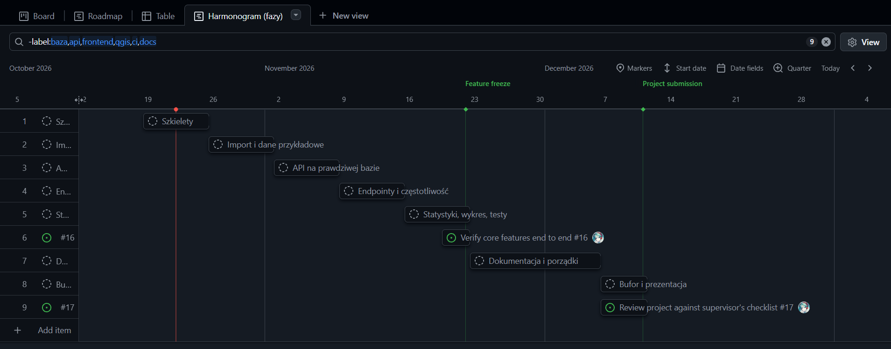
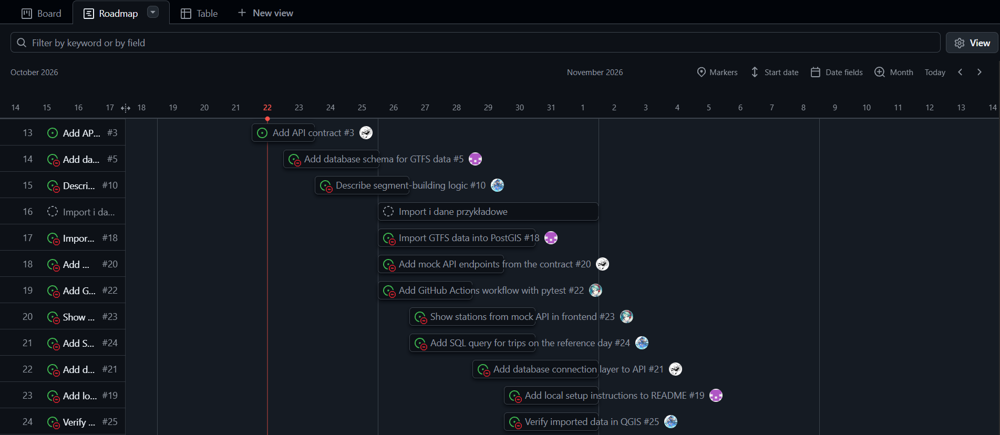

# Mapa i API stacji Kolei Dolnośląskich

Projekt geoinformatyczny, Politechnika Wrocławska, semestr zimowy.

[](https://github.com/g0sie/kd-gtfs-api/actions/workflows/tests.yml)

## Cel projektu

Budujemy bazę danych, API i mapę internetową na podstawie rozkładu jazdy Kolei Dolnośląskich (GTFS). Aplikacja odpowiada na dwa pytania:

1. **Najbliższy pociąg:** jaka stacja jest najbliżej wskazanego punktu i jakie są z niej najbliższe odjazdy.
2. **Częstotliwość połączeń:** które odcinki i stacje mają najwięcej kursów, a które najmniej.

Do tego dochodzą wykres, podstawowe statystyki i możliwość pobrania danych w formacie JSON/GeoJSON przez API.

Pełny plan, podział zadań i harmonogram: [docs/plan-projektu.md](docs/plan-projektu.md).

## Dane

- Źródło: pliki GTFS ze strony [Kolei Dolnośląskich](https://kolejedolnoslaskie.pl/rozklady-gtfs/).
- Rozkład obowiązuje od 19.10.2026 do 12.12.2026.
- Migawka danych (wypakowane pliki GTFS, ok. 1,6 MB) jest w katalogu `data/gtfs/`, a opis źródła i daty pobrania w [data/README.md](data/README.md).
- Licencja i sposób podania źródła: opisane w [data/README.md](data/README.md).

## Technologie

| Warstwa        | Technologia            |
| -------------- | ---------------------- |
| Baza danych    | PostgreSQL + PostGIS   |
| API            | Python, FastAPI        |
| Frontend       | React, Leaflet         |
| Analiza i mapy | QGIS                   |
| Środowisko     | Docker, Docker Compose |
| CI/CD          | GitHub Actions         |

## Struktura repozytorium

```
db/             schemat bazy i skrypty SQL
src/api/        API (FastAPI)
src/frontend/   aplikacja webowa (React + Leaflet)
data/           migawka GTFS (data/gtfs/) i jej opis; duże pliki tymczasowe w data/raw/ (poza repozytorium)
qgis/           projekty QGIS
tests/          testy automatyczne
docs/           dokumentacja, plan projektu, kontrakt API
.github/        workflow CI/CD i szablony
```

## Wymagania

- Docker i Docker Compose,
- Python 3.12 (import danych i testy uruchamiane lokalnie),
- Node.js (tylko do pracy nad frontendem poza kontenerem),
- QGIS (tylko do analiz przestrzennych).

## Uruchomienie

Na tym etapie uruchamiana jest baza danych (PostgreSQL + PostGIS) w Dockerze. API i aplikacja webowa zostaną dodane w kolejnych zadaniach.

### Wymagania

- zainstalowany i uruchomiony Docker (Docker Desktop na Windowsie),
- Python 3.12.

### Środowisko Pythona

Import danych i testy uruchamiane są lokalnie, poza Dockerem. W katalogu repozytorium:

```bash
python -m venv .venv
```

Aktywacja: na Windowsie (PowerShell) `.\.venv\Scripts\Activate.ps1`, na Linuksie i macOS `source .venv/bin/activate`. Potem:

```bash
pip install -r requirements.txt
```

### Start bazy

1. Skopiuj plik ze zmiennymi środowiskowymi. Domyślne wartości działają bez zmian, a jeśli chcesz zmienić hasło, zrób to przed pierwszym startem bazy:
```bash
   cp .env.example .env
```

   W PowerShellu: `Copy-Item .env.example .env`. Plik `.env` jest w `.gitignore` i nie trafia do repozytorium.

2. Uruchom bazę w tle:

```bash
   docker compose up -d
```

3. Sprawdź, że kontener działa:

```bash
   docker compose ps
```
   Poczekaj, aż usługa `db` będzie miała status `(healthy)`. Dopiero wtedy baza przyjmuje połączenia.

### Import danych

Przy włączonym środowisku Pythona i działającej bazie:

```bash
python -m db.import_gtfs data/gtfs
```

Skrypt wczytuje pliki GTFS z `data/gtfs/` do bazy. Czyści tabele i wczytuje dane od nowa, więc można go uruchamiać wielokrotnie, np. po `docker compose down -v`.

### Sprawdzenie PostGIS

Rozszerzenie PostGIS i tabele tworzy automatycznie [db/init.sql](db/init.sql) przy pierwszym starcie bazy. Żeby sprawdzić, że działa, podstaw wartości `POSTGRES_USER` i `POSTGRES_DB` z pliku `.env`:

```bash
docker compose exec db psql -U <POSTGRES_USER> -d <POSTGRES_DB> -c "SELECT postgis_version();"
```

Polecenie powinno zwrócić wersję PostGIS.

### Sprawdzenie danych

Po imporcie baza powinna zawierać 387 stacji:

```bash
docker compose exec db psql -U <POSTGRES_USER> -d <POSTGRES_DB> -c "SELECT count(*) FROM stations;"
```

Pełniejsze sprawdzenie to testy (sekcja [Testy](#testy)): przy działającej bazie z danymi testy bazy nie są pomijane.

### Zatrzymanie

```bash
docker compose down        # zatrzymuje kontenery, dane w wolumenie zostają
docker compose down -v     # zatrzymuje i usuwa dane (baza startuje od zera)
```

Dane bazy są przechowywane w wolumenie Dockera, więc przetrwają restart kontenera.

### Najczęstsze problemy

- **Port jest zajęty:** inny program (np. lokalny PostgreSQL) używa tego samego portu. Zmień port w pliku `.env`: `DB_PORT` (np. `5433`) i ten sam port w `DATABASE_URL`. Pliku `docker-compose.yml` nie trzeba ruszać. Jeśli to inny kontener Dockera, możesz go też zatrzymać: `docker ps`, potem `docker stop <nazwa>`.
- **`the database system is shutting down` przy pierwszym starcie:** po wykonaniu `db/init.sql` baza jeden raz się restartuje. Odczekaj kilka sekund i powtórz polecenie. To samo dotyczy importu uruchomionego zaraz po `up -d`: poczekaj na `(healthy)` w `docker compose ps`.
- **Brak tabel po aktualizacji repozytorium:** `db/init.sql` wykonuje się tylko na pustym wolumenie. Jeśli uruchamiałeś(-aś) bazę, zanim w repozytorium pojawił się schemat albo jego nowa wersja, użyj `docker compose down -v` i uruchom ponownie. Uwaga: to kasuje dane w bazie, więc potem trzeba ponowić import.
- **Zmiana hasła w `.env` nie działa:** baza inicjalizuje się tylko na pustym wolumenie. Użyj `docker compose down -v` i uruchom ponownie.
- **Połączenie z bazą wisi na Windowsie:** w `DATABASE_URL` używaj `127.0.0.1` zamiast `localhost`, który na Windowsie potrafi wisieć (IPv6). Tak jest już w `.env.example`.
- **Import łączy się z inną bazą niż w `.env`:** zmienna `DATABASE_URL` ustawiona w systemie ma pierwszeństwo przed plikiem `.env`. Sprawdź ją przez `$env:DATABASE_URL` (PowerShell) albo `echo $DATABASE_URL` (Linux / macOS).
- **PowerShell blokuje `Activate.ps1`:** `Set-ExecutionPolicy -Scope CurrentUser RemoteSigned`.

Planowane adresy po uruchomieniu (do potwierdzenia):

- API i dokumentacja: http://localhost:8000/docs
- Aplikacja webowa: http://localhost:5173

## Testy

Testy są w katalogu `tests/` i używają `pytest`. Testy API działają na danych przykładowych i nie wymagają bazy. Testy bazy (import i zapytania) wymagają działającej bazy z zaimportowanymi danymi. Gdy jej nie ma, są pomijane (skipped), więc `python -m pytest` działa też bez Dockera, np. w GitHub Actions.

```bash
pip install -r requirements.txt
python -m pytest
```

Testy uruchamiają się automatycznie w GitHub Actions przy każdym pushu i pull requeście.

## Zespół

| Osoba      | Rola                                         |
| ---------- | -------------------------------------------- |
| Dominika   | Baza danych i import danych                  |
| Michał Adamowicz (@Whyfooo)     | QGIS i analiza przestrzenna                  |
| Małgorzata Derkacz (@g0sie) | Frontend i organizacja repozytorium (GitHub) |
| Weronika Mongiało (@wemon007)| API (FastAPI) i testy      |

## Harmonogram

Harmonogram prowadzimy w widoku Roadmap w projekcie GitHub (pola Start date i Target date w zadaniach). Poniżej zrzuty ze stanu na 22.10.2026.

**Fazy projektu:**



**Przykładowe zadania z tygodni 1–2:**



Szczegółowy plan: [docs/plan-projektu.md](docs/plan-projektu.md).


## Zasady pracy

Jak zakładać branche, otwierać pull requesty i korzystać z tablicy zadań: [CONTRIBUTING.md](CONTRIBUTING.md).
